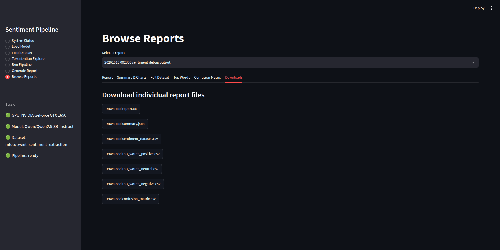

# AI Sentiment Analysis Pipeline

A learning-focused project exploring how to build a text-classification
workflow with a large language model (LLM). The application uses Python,
Streamlit, Hugging Face Transformers, and the `Qwen/Qwen2.5-3B-Instruct`
model to classify text as **negative**, **neutral**, or **positive**,
then saves predictions and generates reports.

> **Project status:** This is an ongoing learning project, not a claim
> of a production-ready sentiment-analysis system. Features and results
> should be validated in the environment where the application is run.

## Project goals

The purpose of this project is to learn how the parts of an LLM
application fit together: loading a model, preparing text, running
inference, saving predictions, and evaluating results.

The project also provides a small Streamlit interface so these steps can
be explored without running every operation manually from a script.

## What the application does

-   **System Status:** Inspect the Python/PyTorch environment and
    available GPU information.
-   **Load Model:** Load a Hugging Face text-generation model and its
    tokenizer.
-   **4-bit quantization:** Optionally use NF4 quantization to reduce
    model-weight memory requirements, depending on hardware and
    installed dependencies.
-   **Load Dataset:** Load a dataset and inspect its rows and columns.
-   **Run Sentiment Analysis:** Choose a text column and classify
    selected rows as negative (`-1`), neutral (`0`), or positive (`1`).
-   **Tokenization Explorer:** Inspect token pieces and token IDs for
    the input text and the complete prompt.
-   **Generate Report:** Summarize predictions and text characteristics,
    and calculate evaluation metrics when compatible ground-truth labels
    are available.
-   **Browse Reports:** Review saved report tables, charts, and
    downloadable output files.

## What I learned and explored

This section describes the concepts explored through the project. It is
a learning record, not a claim that every topic has been mastered or
independently implemented from scratch.

### 1. Using a pretrained language model

-   Loading a pretrained instruction-following model with Hugging Face
    Transformers.
-   Supplying instructions and text in a prompt to guide the model
    toward a constrained classification response.
-   Understanding that a generative model can be used for a
    classification-style task, but its response still needs to be
    checked and interpreted.

### 2. Tokenization and model inputs

-   Exploring how text is split into tokens and converted into token IDs
    before inference.
-   Understanding that tokens may be whole words, word fragments,
    punctuation, or other text pieces.
-   Comparing the tokens for the input text with the tokens for the full
    prompt, including the instructions.
-   Seeing why token counts depend on the tokenizer used by the selected
    model.

### 3. Quantization and memory use

-   Exploring 4-bit NF4 quantization as a way to reduce the memory used
    by model weights.
-   Checking GPU availability and observing GPU memory use while a model
    is loaded.
-   Learning that quantization does not remove all RAM or VRAM
    requirements; inference also needs memory for runtime operations,
    inputs, and generated tokens.

### 4. Connecting the steps into a pipeline

-   Working with a workflow that connects model loading, dataset
    preparation, inference, result storage, and reporting.
-   Using Streamlit to expose the workflow through a local web
    interface.
-   Saving predictions to CSV so they can be inspected and analyzed
    separately from model inference.

### 5. Understanding evaluation

-   Reading a confusion matrix to see which classes are predicted
    correctly and which classes are confused with one another.
-   Exploring precision, recall, F1, macro-F1, and weighted-F1 when
    valid ground-truth labels are available.
-   Learning that evaluation depends on correctly understanding and
    mapping the dataset's original labels.
-   Recognizing that a single accuracy value can hide weak performance
    on a particular sentiment class.

### 6. Learning from errors and limitations

-   Investigating failed or missing model responses instead of
    automatically treating them as neutral.
-   Inspecting misclassified examples to understand where the model
    struggles.
-   Recognizing that sentiment can be ambiguous, especially with
    sarcasm, mixed opinions, short text, or context-dependent language.

## How the application works

1.  **Check the environment.** Inspect package and GPU information.
2.  **Load the model.** Load the selected model and its tokenizer.
3.  **Load a dataset.** Choose a dataset and inspect its columns.
4.  **Select the text column.** Identify the field containing the text
    to classify.
5.  **Run the pipeline.** The model is prompted to return one of the
    sentiment values: `-1`, `0`, or `1`.
6.  **Save predictions.** Write the annotated data to a CSV file.
7.  **Generate a report.** Analyze the saved predictions and create
    report files.
8.  **Browse results.** Review the charts, tables, and available
    downloads.

Start with a small number of rows to test the workflow before processing
a larger dataset.

## Sentiment labels

    Value Meaning    Illustrative example
  ------- ---------- ----------------------------------
     `-1` Negative   "The service was disappointing."
      `0` Neutral    "The package arrived today."
      `1` Positive   "I really enjoyed this."

These examples are illustrative. Real text can be ambiguous, and model
predictions can be wrong.

## Understanding the reports

### Sentiment distribution

Shows the count and percentage of valid predictions classified as
positive, neutral, or negative.

### Polarity score

The average of the numeric sentiment values. A value closer to `1`
indicates a more positive set of predictions, while a value closer to
`-1` indicates a more negative set. A value near zero can reflect
neutral predictions or a mixture of positive and negative predictions,
so it should not be interpreted on its own.

### Text lengths and common words

The report summarizes text length and lists frequent words for each
predicted sentiment. This is basic frequency analysis; it does not
explain why the model produced a particular prediction.

### Confusion matrix

When compatible ground-truth labels are available:

-   **Rows** represent the actual labels from the dataset.
-   **Columns** represent the model's predictions.
-   **Diagonal cells** represent correct predictions.
-   **Off-diagonal cells** show which labels were confused.

The matrix is meaningful only if the dataset's label meanings and
mapping are correct. Verify that mapping before relying on evaluation
results.

### Precision, recall, and F1

When valid ground-truth labels and predictions are available, the report
can show:

-   **Precision:** Of the examples predicted as a class, how many
    actually belong to that class?
-   **Recall:** Of the examples belonging to a class, how many did the
    model correctly identify?
-   **F1 score:** A combined measure of precision and recall.
-   **Macro-F1:** The average F1 across classes, giving each class equal
    weight.
-   **Weighted-F1:** The average F1 weighted by the number of examples
    in each class.

A model can perform well on one class and poorly on another. Review
class-level metrics and misclassified examples instead of relying only
on an overall score.

### Failed predictions

If the model response cannot be interpreted as a valid sentiment value,
the result should be treated as failed or missing rather than silently
counted as neutral. Check the generated report and CSV to understand how
such rows are represented in the current implementation.

## Screenshots

Place the PNG files in `docs/images/` using the filenames below. GitHub
will display them when the files are committed at those paths.

### Main application

  -----------------------------------------------------------------------------
  System Status                            Load Model
  ---------------------------------------- ------------------------------------
     Model](docs/images/load_model.png)

  -----------------------------------------------------------------------------

  ----------------------------------------------------------------------------------
  Load Dataset                             Run Pipeline
  ---------------------------------------- -----------------------------------------
     Pipeline](docs/images/run_pipeline.png)

  ----------------------------------------------------------------------------------

  ---------------------------------------------------------------------------------------------
  Generate Report                            Tokenization Explorer
  ------------------------------------------ --------------------------------------------------
     Explorer](docs/images/tokenization_explorer.png)

  ---------------------------------------------------------------------------------------------

### Browse Reports

  ---------------------------------------------------------------------------------------------------------------
  Report overview                                    Summary and charts
  -------------------------------------------------- ------------------------------------------------------------
     charts](docs/images/browse_reports_summary_and_charts.png)

  ---------------------------------------------------------------------------------------------------------------

  -------------------------------------------------------------------------------------------------------------
  Confusion matrix                                           Top words
  ---------------------------------------------------------- --------------------------------------------------
     words](docs/images/browse_reports_top_words.png)

  -------------------------------------------------------------------------------------------------------------

  ----------------------------------------------------------------------------------------------------------------
  Full dataset                                            Downloads
  ------------------------------------------------------- --------------------------------------------------------
  
  dataset](docs/images/browse_reports_full_dataset.png)   

  ----------------------------------------------------------------------------------------------------------------

Expected screenshot filenames:

-   `system-status.png`
-   `load_model.png`
-   `load_dataset.png`
-   `run_pipeline.png`
-   `generate_report.png`
-   `tokenization_explorer.png`
-   `browse_reports_report.png`
-   `browse_reports_summary_and_charts.png`
-   `browse_reports_confusion_matrix.png`
-   `browse_reports_top_words.png`
-   `browse_reports_full_dataset.png`
-   `browse_reports_downloads.png`

Ensure screenshots do not expose access tokens, secrets, or private
dataset information.

## Tech stack

-   Python
-   Streamlit
-   Hugging Face Transformers
-   Hugging Face Datasets
-   PyTorch
-   pandas
-   Plotly (for interactive charts, where used)
-   Optional 4-bit NF4 quantization dependencies, depending on the
    environment

Check the project's actual dependency file and imports for the
definitive list of required packages.

## Run locally

### 1. Create and activate a virtual environment

On Linux:

``` bash
python -m venv .venv
source .venv/bin/activate
```

### 2. Install dependencies

If `requirements.txt` is present:

``` bash
python -m pip install -r requirements.txt
```

PyTorch and GPU support can be environment-specific. Install a
compatible PyTorch build and any quantization dependencies required by
your setup.

### 3. Configure Hugging Face access if required

Some models or datasets may require authentication or acceptance of
access terms. Follow the project's authentication setup. **Do not commit
access tokens or secrets to the repository.**

### 4. Start the application

``` bash
streamlit run app.py
```

Open the local address printed by Streamlit.

### 5. Suggested first run

1.  Open **System Status**.
2.  Load the model in **Load Model**.
3.  Load a dataset in **Load Dataset**.
4.  Select the text column.
5.  Run a small sample in **Run Pipeline**.
6.  Generate a report.
7.  Inspect the results in **Browse Reports**.
8.  Use **Tokenization Explorer** to inspect how the loaded model
    tokenizes text.

## Output files

Exact output paths depend on the settings used in the app. The current
workflow may create files such as:

-   `reports_csv_files/sentiment_debug_output.csv` --- annotated dataset
    output.
-   `reports/` --- generated report folders.
-   `sentiment_dataset.csv` --- dataset included with a report.
-   `summary.json` --- summary and evaluation information.
-   `report.txt` --- readable text summary.
-   `top_words_positive.csv`, `top_words_neutral.csv`, and
    `top_words_negative.csv` --- frequent words by predicted sentiment.
-   `confusion_matrix.csv` --- confusion matrix when compatible
    ground-truth labels are available.

Confirm the actual paths in your local configuration and generated
reports.

## Main project files

  -----------------------------------------------------------------------
  File                                Purpose
  ----------------------------------- -----------------------------------
  `app.py`                            Streamlit interface and application
                                      workflow.

  `sentiment_pipeline.py`             Sentiment inference and related
                                      pipeline/report logic.

  `model_manager.py`                  Model loading and configuration
                                      helpers.

  `dataset_loader.py`                 Dataset loading helpers.

  `hardware_preparation.py`           Hardware and PyTorch preparation
                                      helpers.

  `hugging_face_authentication.py`    Hugging Face authentication helper.
  -----------------------------------------------------------------------

File names and responsibilities may differ if the local project has been
reorganized.

## Limitations and next steps

-   The model can misclassify text, particularly sarcasm, mixed
    sentiment, short phrases, and context-dependent language.
-   Evaluation metrics depend on the correctness of the dataset labels
    and their mapping.
-   Common-word analysis is a basic frequency count, not an explanation
    of model behavior.
-   Token counts vary by model and tokenizer.
-   Quantization may reduce model-weight memory requirements, but total
    memory use depends on the hardware and runtime.
-   Processing large datasets can take time because inference is
    performed over individual records in the current workflow.

Possible next steps include testing on more datasets, reviewing
misclassified examples, improving output validation, documenting
measured performance, and testing across supported hardware
configurations.

## Credits and learning resources

This project is part of my AI engineering learning journey. 
I used the following resources to study sentiment analysis, 
understand the original implementation, and learn the concepts 
involved in building an LLM-based application.

-   **Original repository:** [[Mohamad-Hachem/AI_sentiment_analysis_pipeline](https://github.com/Mohamad-Hachem/AI_sentiment_analysis_pipeline.git)]
-   **YouTube tutorial or channel:** [[AI Career Lab](https://www.youtube.com/@AI_Career_Lab)]

This repository documents my learning, experimentation, and project modifications. 
Any original code that has been reused or adapted should be appropriately attributed to its source.